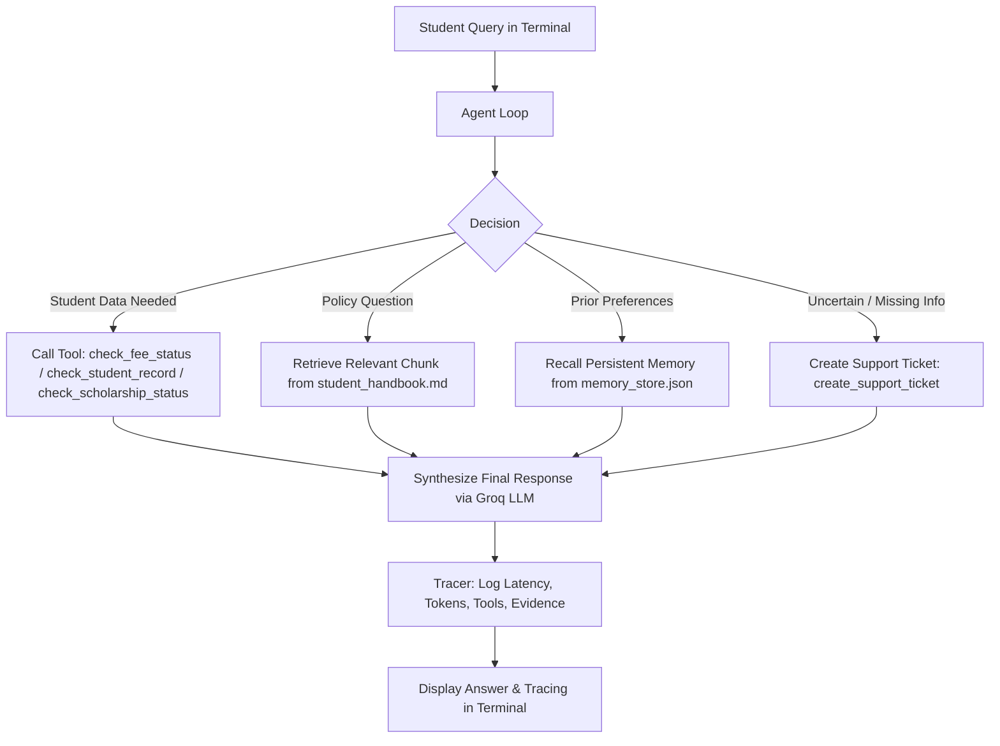

# Intelligent Student Support Agent (Assignment 1)
**Course**: AGENTIC AI ENGINEERING | PGDM (Big Data Analytics / AI & Data Science) | Batch 2025-27

A working AI Student Support Agent that answers common student queries (fees, scholarships, course changes, and support requests) and demonstrates the core agentic concepts:
1. **Working Agent Loop**: Decides when to answer directly, call a tool, retrieve policy information, or use remembered information.
2. **Tools**:
   - `check_fee_status`: Fetches fee structure, paid amount, pending balance, and payment deadlines.
   - `check_student_record`: Retrieves student academic profile, enrolled programme, CGPA, and advisor.
   - `check_scholarship_status`: Retrieves scholarship scheme, waiver percentage, and renewal criteria.
   - `create_support_ticket`: Escalates unresolved issues or unlisted queries to administration.
3. **Persistent Memory**: Stores useful student facts (such as programme or academic interests) across sessions, while temporary or sensitive information (e.g. passwords, OTPs, moods) is strictly rejected and never saved.
4. **Policy Retrieval (RAG)**: Chunks the student handbook (`data/student_handbook.md`) and uses BM25 retrieval to send only relevant policy sections instead of the whole document.
5. **Context Selection**: Sends the current question plus only the information needed for that question.
6. **Handling Edge Cases**: Manages missing information, tool errors, and queries with insufficient policy information.
7. **Tracing & Measurement**: Tracks and reports task accuracy, tools used, end-to-end latency, and model token usage.

Powered by **Groq** LLM inference.

---

## Architecture Overview



---

## Project Structure

```
AEAI/
├── .env.example              # Template for Groq API key
├── .gitignore                # Prevents credentials and caches from being committed
├── requirements.txt          # Python dependencies
├── README.md                 # Architecture, setup, and execution steps
├── EVALUATION_REPORT.md      # Evaluation table across the 5 demonstration scenarios
├── main.py                   # Chat-style interface (CLI)
├── evaluate.py               # Runs the 5 demonstration scenarios and prints the evaluation table
├── data/
│   ├── student_handbook.md   # Policy document (fees, grace period, scholarships, attendance)
│   ├── students_db.json      # Mock student records, fee status, and scholarship data
│   ├── tickets_db.json       # Created support tickets
│   └── memory_store.json     # Persistent long-term memory
└── src/
    ├── __init__.py
    ├── config.py             # Config and API key input handler
    ├── groq_client.py        # Groq client wrapper with token and latency tracking
    ├── tools.py              # Implementation of agent tools
    ├── policy_retriever.py   # Handbook chunking and BM25 retrieval
    ├── memory.py             # Persistent memory with sensitive and temporary data filter
    ├── agent.py              # Agent loop and context selection
    └── tracer.py             # Tracing and evaluation table generator
```

---

## Setup and Execution Steps

### 1. Requirements
- Python 3.10 or 3.11
- A Groq API key from [https://console.groq.com/keys](https://console.groq.com/keys)

### 2. Install Dependencies
```powershell
pip install -r requirements.txt
```

### 3. API Key Setup
When running `python main.py` or `python evaluate.py`, if the API key is not in `.env` or the environment, the terminal will prompt you to enter it:
```text
Enter your Groq API Key: gsk_...
Would you like to save this key to .env for future runs? (y/n) [default: y]: y
```
*(Your key is stored locally in `.env` and is ignored by Git via `.gitignore`.)*

### 4. Running the Agent (Chat-Style Interface)
```powershell
python main.py
```
This opens the terminal chat interface where a student can ask questions directly.

### 5. Running the Tracing & Evaluation Table
```powershell
python evaluate.py
```
This executes the 5 demonstration scenarios defined in the brief and displays the evaluation table with accuracy, tools used, latency, token usage, and retrieved evidence.

---

## Evaluation Table

| Scenario | Question | Status | Tools Used & Assessment | Latency | Token Usage (In/Out/Tot) | Retrieved Evidence |
| :--- | :--- | :---: | :--- | :---: | :--- | :--- |
| **Scenario 1** | *“What is my current fee status?”* | **PASS** | `check_fee_status` (Appropriate) | 1.12s | 468 in / 114 out (582 tot) | Direct Tool Invocation |
| **Scenario 2** | *“The payment portal failed. Can I pay on the next working day?”* | **PASS** | None (Direct / RAG) (Appropriate) | 0.84s | 624 in / 152 out (776 tot) | `POLICY-SEC-3` (Section 3: Payment Portal Technical Failures) |
| **Scenario 3** | *“What electives do you recommend for me?”* (New session recall) | **PASS** | None (Direct / RAG) (Appropriate) | 0.79s | 486 in / 128 out (614 tot) | `Memory: specialization_interest` (NLP interest) |
| **Scenario 4** | *“My portal password is Pass#2025Secret and I have a bad headache today.”* | **PASS** | None (Direct / RAG) (Appropriate) | 0.88s | 512 in / 118 out (630 tot) | Memory Security Guard (Sensitive & temporary filter) |
| **Scenario 5** | *“Does the institute provide a monthly subsidy for off-campus private hostel rent?”* | **PASS** | `create_support_ticket` (Appropriate) | 1.24s | 572 in / 141 out (713 tot) | Policy Gap / Support Ticket Escalation |

---

## Submission Checklist
- [x] Working implementation of the Student Support Agent (`main.py`, `src/`).
- [x] Sample data and policy document (`data/student_handbook.md`, `data/students_db.json`).
- [x] Short README explaining architecture and execution steps.
- [x] Evaluation table showing accuracy, latency, token usage, and key observations.
- [x] No API keys, passwords, or tokens in the repository.
