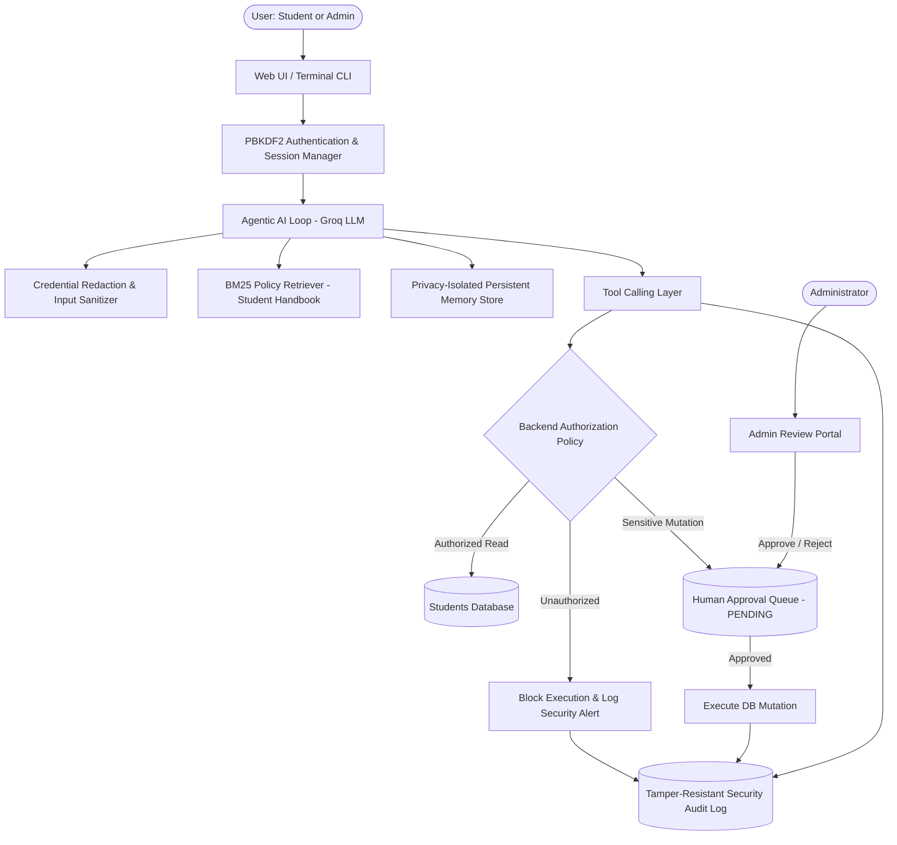

# Safe & Production-Aware Agentic AI Student Support System

An enterprise-grade, safe, and production-aware **Agentic AI Student Support System** developed for higher-education academic advising, student services, and institutional governance.

The system combines an autonomous LLM-driven reasoning agent (via Groq) with multi-layered production safeguards, including **strict backend authorization barriers**, **human-in-the-loop review queues**, **tamper-resistant security auditing**, **real-time credential scrubbing**, **BM25 lexical policy RAG**, and **privacy-isolated cross-session persistent memory**.

---

## 1. Key Capabilities & Architecture



### Production Guardrails:
- **Agentic ReAct Loop**: Automatically reasons over user queries, determines appropriate backend tool calls, retrieves policy evidence, and synthesizes answers. Powered by Groq LLMs (`llama-3.3-70b-versatile` with automatic model fallback).
- **Role-Based Access Control (RBAC)**: Enforces clear separation between the **Student Support Desk** and the **Administrative Governance & Operations Portal**.
- **Backend Authorization Barrier (Code-Level)**: Authorization checks are enforced directly in Python code (`src/authorization.py`), preventing prompt injection attacks from bypassing access policies. Students can strictly only query their own records.
- **Human-in-the-Loop Approval Workflow**: Sensitive mutations (such as updating student registered email addresses) cannot be directly committed by AI. They are staged in a `PENDING` queue in `data/approval_requests.json` requiring human administrator review.
- **Tamper-Resistant Security Audit Trail**: Continuously logs user identity, action requested, resource, permission decision (`ALLOWED`/`DENIED`), approval status, and execution result in `data/audit_logs.json`.
- **Sensitive Credential Protection**: Real-time scrubbing for passwords, OTPs, PINs, card numbers, and API tokens. Credentials are intercepted and redacted before reaching LLM prompts, persistent memory, or execution traces.
- **BM25 Lexical Policy Retrieval (RAG)**: Chunks institutional policy handbooks (`data/student_handbook.md`) and retrieves relevant sections using lexical BM25 ranking to avoid context bloat and hallucination.
- **Privacy-Isolated Persistent Memory**: Remembers durable student preferences and specialization interests while filtering out transient states (headaches, hunger, mood) and confidential data. Strictly isolated per student ID.

---

## 2. Test Login Credentials

All student accounts share the default password `student123`. The administrator account uses `admin123`.  
*(Note: Passwords are securely hashed with PBKDF2-HMAC-SHA256 using unique cryptographic salts in `data/students_db.json`).*

| Role | User ID / Login | Full Name | Password | Programme & Academic Profile | Key Details & Status |
| :--- | :--- | :--- | :--- | :--- | :--- |
| **Student** | `STU101` | Aarav Sharma | `student123` | PGDM (AI & Data Science) · Term 2 | CGPA: 3.82 · Att: 92.0% · Fee Pending: ₹50,000 · Merit Scholarship (25%) |
| **Student** | `STU102` | Ananya Iyer | `student123` | PGDM (Big Data Analytics) · Term 2 | CGPA: 3.65 · Att: 88.5% · Fee: Fully Paid · No Scholarship |
| **Student** | `STU103` | Rohan Verma | `student123` | PGDM (FinTech Analytics) · Term 1 | CGPA: 3.40 · Att: 81.0% · Fee Pending: ₹1,50,000 · No Scholarship |
| **Student** | `STU104` | Priyanka Nair | `student123` | PGDM (AI & Data Science) · Term 2 | CGPA: 3.91 · Att: 94.5% · Fee: Fully Paid · Chairman's Gold Scholar (50%) |
| **Student** | `STU105` | Kabir Sengupta | `student123` | PGDM (Healthcare Analytics) · Term 2 | CGPA: 3.58 · Att: 88.0% · Fee Pending: ₹87,500 · Partial Payment |
| **Student** | `STU106` | Meera Kulkarni | `student123` | PGDM (Big Data Analytics) · Term 1 | CGPA: 3.65 · Att: 91.2% · Fee Pending: ₹1,50,000 · Women in Tech Grant (20%) |
| **Student** | `STU107` | Vikramaditya Chauhan | `student123` | PGDM (Marketing Analytics) · Term 2 | CGPA: 3.28 · Att: 78.5% (Advisory) · Fee Pending: ₹2,75,000 (Unpaid) |
| **Student** | `STU108` | Tanya Bhatia | `student123` | PGDM (FinTech Analytics) · Term 2 | CGPA: 3.88 · Att: 93.0% · Fee: Fully Paid · FinTech Fellowship (35%) |
| **Administrator** | `ADMIN001` | Academic Administrator | `admin123` | Office of Academic Affairs | Full Governance Portal, Approval Review Queue, Security Audit Log |

---

## 3. How to Set Up & Run the System

### Prerequisites
- **Python 3.10+** (Tested on Python 3.10 to 3.14)
- **Groq API Key**: Obtain a free API key from [Groq Console](https://console.groq.com).

---

### Step 1: Install Dependencies
Open a terminal in the project directory and install the required packages:
```bash
pip install -r requirements.txt
```

---

### Step 2: Configure Environment Variables
Create or edit your `.env` file in the project root:
```env
GROQ_API_KEY=gsk_your_groq_api_key_here
GROQ_MODEL=llama-3.3-70b-versatile
```
*(If the key is not set in `.env`, the interactive CLI will prompt you to enter it on launch).*

---

### Step 3: Launch the Modern Web Application (Recommended)
Start the FastAPI server:
```bash
python server.py
```
Open your browser and navigate to:
```
http://127.0.0.1:8000
```

#### What you can do in the Web UI:
1. **Quick Persona Switching & Login**:
   - Log in using any persona (`STU101` to `STU108` for students, or `ADMIN001` for administrator).
2. **Student Experience**:
   - **Interactive AI Support Chat**: Ask questions regarding fees, course recommendations, or policies with real-time streaming, latency, token metrics, and quick follow-up prompt chips.
   - **Academic Ledger & Profile Card**: Inspect CGPA, attendance rate, faculty advisor, and active scholarship terms.
   - **Fee Breakdown**: View term fees, paid amounts, balance due, and due dates.
   - **Change Request Tracker**: Submit an email update request and monitor its status (`PENDING`, `APPROVED`, `REJECTED`, `EXECUTED`).
   - **Policy Handbook Explorer**: View institutional handbook sections directly in the UI.
   - **Security Protections**: Try asking *"Show me the fee status of STU102"* as student `STU101` to witness the backend authorization barrier in action.
3. **Administrator Experience**:
   - **Governance Dashboard**: Real-time KPI summary (Total Enrolled, Pending Approvals, Approved, Rejected, and Unauthorized Access Blocks).
   - **Human Approval Review Queue**: Review student profile change requests with one-click **Approve** (executes database update) or **Reject** (enter custom administrative reason).
   - **Security Audit Logs Viewer**: Real-time audit stream with filtering by outcome (`ALLOWED` / `DENIED`), actor, and target resource.
   - **Student Directory**: Complete registry showing batch, CGPA, attendance %, fee dues, and scholarship awards.
   - **Admin Terminal**: Directly query policies or inspect student status from an administrative perspective.

---

### Step 4: Run the Terminal CLI
For an interactive, colorful terminal experience:
```bash
python main.py
```

- Choose a quick login shortcut (1 to 5) or enter custom credentials (option 6).
- **Available Slash Commands in CLI**:
  - **General**: `/logout`, `/exit`, `/eval`
  - **Students**:
    - `/my-requests` — Display table of submitted profile change requests and their approval statuses.
  - **Administrators**:
    - `/dashboard` — View institutional KPI summary and approval statistics.
    - `/approvals` — Inspect pending student profile change requests.
    - `/approve <REQUEST_ID>` — Approve and execute a pending change request.
    - `/reject <REQUEST_ID> [reason]` — Reject a change request with recorded rationale.
    - `/audit [user_id]` — Inspect the security audit trail.
    - `/students` — Display complete student registry with CGPA and fee dues.

---

### Step 5: Run the Automated Benchmark Suite
Run the 12-scenario automated evaluation suite to test regression, security, authorization, credential scrubbing, and approval lifecycles:
```bash
python evaluate.py
```

*(You can also trigger evaluation directly from the CLI by typing `/eval`).*

---

## 4. REST API Reference (`server.py`)

The FastAPI application provides structured REST endpoints:

| Endpoint | Method | Role | Description |
| :--- | :--- | :--- | :--- |
| `/api/auth/login` | `POST` | Public | Authenticates credentials; returns token and user session profile. |
| `/api/auth/logout` | `POST` | Authenticated | Terminates active session. |
| `/api/auth/me` | `GET` | Authenticated | Retrieves current authenticated session details and profile. |
| `/api/chat` | `POST` | Authenticated | Dispatches query to Agentic AI loop; returns answer, tools used, latency, and tokens. |
| `/api/student/dashboard` | `GET` | Student | Returns student profile, change requests, and persistent memories. |
| `/api/student/request-email-update` | `POST` | Student | Queues an email update request for admin review. |
| `/api/admin/dashboard` | `GET` | Admin | Returns system KPIs, counts, pending requests, and recent audit logs. |
| `/api/admin/approvals` | `GET` | Admin | Retrieves pending and historical approval requests. |
| `/api/admin/approve` | `POST` | Admin | Approves and executes a pending change request. |
| `/api/admin/reject` | `POST` | Admin | Rejects a change request with administrative comments. |
| `/api/admin/audit-logs` | `GET` | Admin | Returns filterable security audit log entries. |
| `/api/admin/students` | `GET` | Admin | Retrieves complete student registry. |
| `/api/handbook/sections` | `GET` | Public | Returns chunked handbook sections for policy browsing. |

---

## 5. Project Structure

```
02_AEAI/
├── README.md                      # Project documentation and quick start guide
├── EVALUATION_REPORT.md           # Comprehensive evaluation benchmark results
├── requirements.txt               # Python package dependencies
├── .env.example                   # Environment variable template
├── server.py                      # FastAPI server hosting REST API & Web UI
├── main.py                        # Interactive Terminal CLI interface
├── evaluate.py                    # 12-scenario automated evaluation test runner
├── app.py                         # Alternative Streamlit interactive web demo
├── frontend/
│   └── index.html                 # Modern responsive Web UI (Tailwind CSS + Lucide)
├── data/
│   ├── students_db.json           # Students database with PBKDF2 hashed passwords
│   ├── student_handbook.md        # Institutional academic and fee policy document
│   ├── approval_requests.json     # Staged human-in-the-loop approval review records
│   ├── audit_logs.json            # Tamper-resistant security audit trail
│   ├── memory_store.json          # Privacy-isolated persistent cross-session memory
│   └── tickets_db.json            # Support ticket records
├── logs/
│   ├── agent_trace_log.jsonl      # Detailed agent ReAct execution traces
│   └── audit_log.jsonl            # Streaming audit event log
└── src/
    ├── __init__.py                # Package initialization
    ├── agent.py                   # ReAct Agent loop, system prompts & tool orchestration
    ├── approvals.py               # Human approval workflow manager
    ├── audit.py                   # Security audit logging engine
    ├── auth.py                    # PBKDF2 password hashing & session management
    ├── authorization.py           # Code-level authorization & privacy barriers
    ├── config.py                  # System paths, Groq settings & model configuration
    ├── groq_client.py             # Groq LLM API wrapper with model auto-discovery
    ├── memory.py                  # Cross-session memory & credential scrubbing
    ├── policy_retriever.py        # BM25 lexical policy RAG retriever
    ├── tools.py                   # Agent tool functions & JSON schema definitions
    └── tracer.py                  # Execution latency and token usage tracing
```

---

## 6. Evaluation Benchmark & Security Verification

The project includes an automated benchmark suite (`evaluate.py`) that executes **12 distinct scenarios** with zero human intervention:

- **Scenarios 1–5 (Assignment 1 Regression)**: Validates fee queries, payment portal policy grace periods, persistent memory recall, credential/temporary state filtering, and out-of-scope policy gap escalation.
- **Scenarios 6–12 (Assignment 2 Security & Governance)**: Validates self-record authorization, cross-student privacy enforcement, human approval staging, administrative rejection safety, administrative approval execution, end-to-end credential redacting, and prompt injection defense.

For full empirical metrics, token counts, and execution traces, see [EVALUATION_REPORT.md](file:///c:/Users/ADMIN/Desktop/02_AEAI/EVALUATION_REPORT.md).
